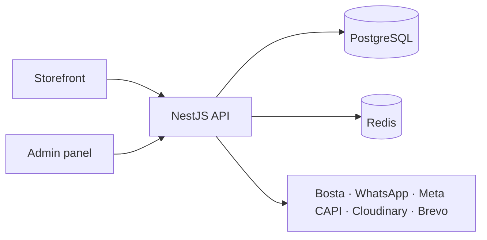

# Gamers Core

A live bilingual (Arabic/English) e-commerce platform for a gaming-accessories business in Egypt, built end to end as three connected apps. It replaced a manual Shopify workflow with automated customer verification, WhatsApp order confirmation and Bosta shipping.

**Live:** [gamers-core.net](https://gamers-core.net)

| Repo | What it is |
| --- | --- |
| [frontend](https://github.com/Gamers-Core/frontend) | Customer storefront (Next.js, English/Arabic, RTL) |
| [admin](https://github.com/Gamers-Core/admin) | Back office for orders, catalogue, discounts and content (Next.js) |
| [backend](https://github.com/Gamers-Core/backend) | REST API (NestJS, PostgreSQL, Redis) with Bosta, WhatsApp, Meta CAPI and Cloudinary integrations |

**Results:** average search time cut from ~4s to ~1s, page size from 80KB+ to under 10KB, and page load reduced by ~3s through full-page caching and EU-region hosting.

Built and maintained solo by [Omar Lawatey](https://github.com/OmarLawaty).
